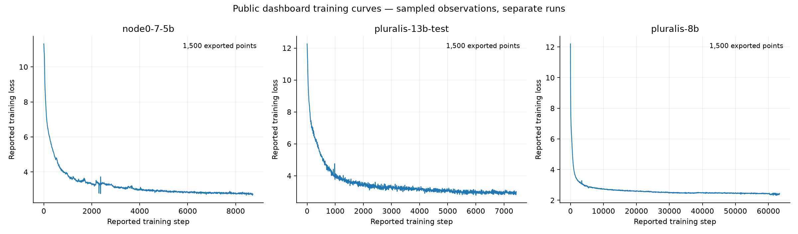
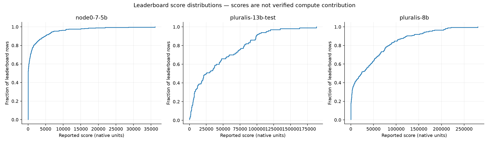
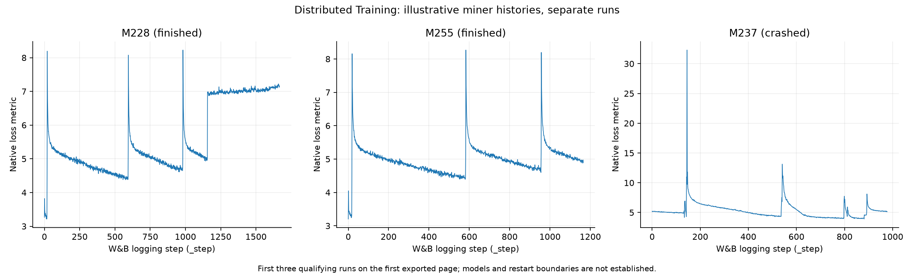
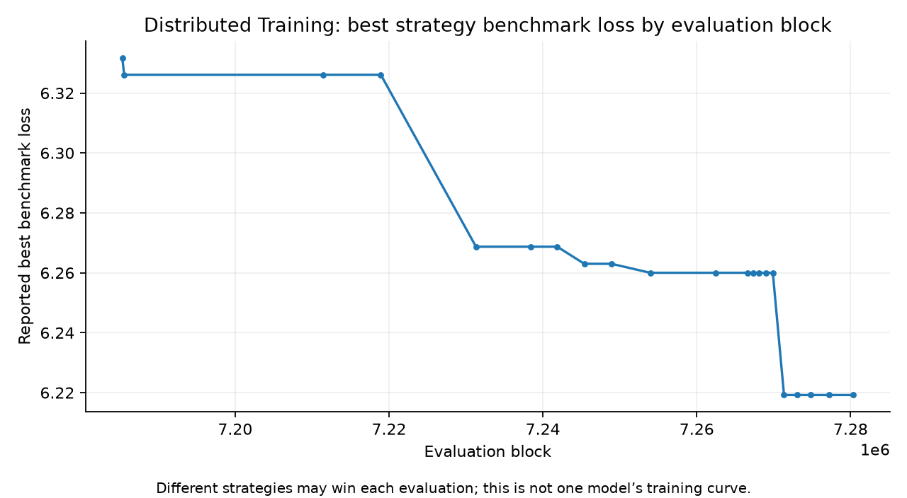

# Public decentralized training evidence

This collection preserves public source code, dashboard responses and linked
research artifacts for Node0, Gensyn RL Swarm, Distributed Training and Agora.
The exports support analysis of reported participation and training behavior;
they do not independently establish useful compute contributed by each node.
Collection took place on 29 October 2026. Historical run dates and source
timestamps remain in the raw responses.
The exports span multiple requests and are not an atomic snapshot of all services.
Run-list and history-count checks refer to the values recorded during collection.

## Dashboard snapshots

Open the [local screenshot gallery](DASHBOARDS.html). It contains 30 requested
views: eight tabs for each of the two Agora runs and the Node0 run, three Gensyn
dashboard hosts, two SN38 pages and the separate Node0 dashboard access attempt.
Every view has original HTML, rendered DOM, PNG, PDF, MHTML and browser logs.
Seventeen additional scroll-pane images preserve portions below the first viewport.
All 24 named run/tab selections match the requested tab in the saved DOM.
[The inventory](DASHBOARD_SNAPSHOTS.json) records timestamps, selections and hashes.
The selected final captures occupy 220,872,658 payload/artifact bytes; earlier
attempts are retained separately and included in overall storage verification.

These are presentation snapshots with explicit limitations:

- Agora/Node0 overview and telemetry charts are visible in the saved PNGs.
  MHTML opened offline but lost canvas plots; it is **not** a fully functioning
  offline dashboard. Use PNGs for appearance and API exports for numbers.
- Some internal scrolling panes were not captured beyond the initial viewport;
  those selector failures are recorded. Long tables and unselected filters are
  not exhaustively photographed. Raw returned peer/leaderboard data is separate.
- Evaluation tabs displayed no published evaluation results. The separate Node0
  dashboard returned HTTP 403, whose page is retained.
- SN38 mechanism-1 loaded its strategy cards and charts. Its `/train` page still
  displayed loading placeholders after 30 seconds, with no WebSocket frames
  received. Those missing curves are not claimed as archived.
- Chromium evicted some large response bodies from its inspector cache; these
  are explicit browser-capture gaps. Earlier raw API archives remain separate,
  with their original timestamps. Blocked requests and load errors are retained.

Five representative MHTML files were opened with JavaScript disabled and network
offline; [the offline review](OFFLINE_DASHBOARD_CHECK.json) records the results.
The gallery itself uses only local images and can be viewed without the live sites.

## Source checkouts

| Project | Local checkout | Recorded commit |
| --- | --- | --- |
| [Node0](https://github.com/PluralisResearch/node0) | `research/node0/upstream` | `32bd084de15dbdc8e30723ad66db7d01acf70c03` |
| [Gensyn RL Swarm](https://github.com/gensyn-ai/rl-swarm) | `research/gensyn/upstream` | `286c17e5391fa3e9ebba64a8e683bb36e47376a8` |
| [Distributed Training](https://github.com/dstrbtd/DistributedTraining) | `research/distributed-training/upstream` | `082f3a632cd412e688a325356af08e34f01d8b8e` |
| [Agora](https://github.com/PluralisResearch/agora) | `research/agora/upstream` | `37d29a966528675635161007d7b43388012a98b2` |

The three requested clones contain Git history. The existing Agora checkout was
preserved. These revisions identify the archived source; they do not identify
the software revision deployed in each historical run. Distributed Training
refers to the historical SN38 project linked above, not every later project
using subnet number 38.

## Agora and Node0

The shared [Pluralis run registry](https://agora.pluralis.ai/api/runs) exposes
three completed runs. Their saved peers, leaderboards, worker telemetry and
training endpoints provide the following observations:

| Run | Reported model | Peer records | Leaderboard rows | Sampled loss observations | First to last sampled loss |
| --- | --- | ---: | ---: | ---: | --- |
| `node0-7-5b` | OLMo2-7.5B | 1,642 | 303 | 1,500 | 11.31 → 2.734 |
| `pluralis-8b` | Pluralis-8B | 592 | 176 | 1,500 | 12.197 → 2.438 |
| `pluralis-13b-test` | Pluralis-13B | 1,215 | 100 | 1,500 | 12.259 → 3.006 |

These are sampled points with gaps in reported step indices, even when the API
request uses `range=all`. The decline describes observed training progress; it
does not establish final convergence, generalization or successful training
under adversarial conditions. The 8B evaluation endpoint returned an empty
task collection despite the registry advertising evaluation support.

Node0 supplies 1,193,858 non-null worker telemetry cells; the two Agora runs
supply 2,776,026 combined. Raw matrices preserve nulls, while compressed CSV
tables contain observed values. A missing cell is not zero activity. Peer rows,
usernames and telemetry worker names are separate identifiers; no undocumented
cross-table identity mapping was invented.

The dashboard describes its leaderboard score as FLOPs plus presence credit,
divided by a scaling factor. Scores therefore cannot be interpreted as measured
compute contribution alone. Likewise, the registry's `1.3T` token label describes
dataset metadata, not the run's processed-token total. Native fields and source
references are retained for a more detailed audit.

See the [Node0 evidence report](../node0/PUBLIC_RUNS.md) and
[Agora evidence report](../agora/PUBLIC_RUNS.md) for exact snapshot paths and
inventories. The separate README-linked Node0 dashboard returned HTTP 403;
the historical run was accessible through the shared registry.

## Gensyn RL Swarm

The primary, legacy math and legacy swarm dashboard hosts each returned 100
leaderboard rows. Host provenance is retained even where returned IDs overlap.
Across these 300 rows there are 198 distinct reported peer IDs; the math and
swarm hosts returned the same set of 100 IDs in this collection.
These top lists are not a complete historical participant census or a count of
distinct human operators. The archive includes 202 source-specific gossip
records and aggregate round, reward and participation responses.
The dashboard client labels the native score as participation; neither score
nor reward supplies GPU-hours or a validated amount of useful compute.

Five models in the official Hugging Face collection have archived metadata and
model cards. A paginated name search also returned 11,223 candidate repositories
containing `Gensyn-Swarm`. Those names do not prove participation. Repository
history preserves Reasoning Gym and CodeZero configurations, but their defaults
cannot establish the model run by a particular dashboard peer.

The technical report describes a small three-model experiment, distinct from
public deployment telemetry. No raw per-peer learning histories or linked
global W&B project were found in the consulted official sources. The dashboard
APIs expose snapshots rather than downloadable historical training traces.
Current and older official pages also disagree about whether a swarm is active;
the archive preserves that disagreement without asserting live training.

See the [Gensyn evidence report](../gensyn/PUBLIC_RUNS.md) for the source-specific
counts, model/version differences and unavailable endpoints.

## Distributed Training

The collection includes the public mechanism-1 strategy dashboard and linked
W&B projects. The dashboard's best benchmark loss compares evaluated strategies
at particular blocks; it is not a sequential training curve for one model.
W&B histories retain project and run identities so independent miners and
validators are not merged into a fictitious global trajectory.

The saved run listings contain 2,627 distinct miner runs, 92 validator runs and
5 DeMoCo runs. Each listing reaches a terminal pagination cursor and matches its
public `runCount`: 2,724 run identities in total. This establishes listing
coverage at collection time, not complete metric-history coverage or 2,724
distinct participants.

Among 364 runs whose sampled history counts differed from the reported count or
were unknown, 100 received step-window scans. Of these, 92 passed both the
expected-range and reported-row-count checks; 272 candidates remained unscanned
or not fully validated. The scans returned 1,438 ranges and 465,293 unique rows.
This bounded snapshot is stopped and does not contain every historical metric.

For node-level analysis, miner histories contain native fields such as `loss`,
`samples_accumulated`, `outer_step`, `inner_step`, `download`, `upload`, `ping`,
`incentive` and `emissions`. Validator histories include `average_miner_loss`,
per-UID training/all-reduce scores and durations, and `weights.uid<N>` series.
These are useful starting points for studying reported activity and rewards;
they are not verified FLOPs or GPU-hours. In the pinned source, network speed
fields come from `speedtest` (`distributed_training/utils/misc.py:171`), and
validator scores are computed in `distributed_training/validator/reward.py:650`.
The historical deployment revision remains unknown.

Concrete raw examples are miner `page-0000.json` and validator
`history-windows/V176-steps-500-503-q-4142b5d5d24a.json`, under their respective
`raw/wandb/kmfoda/distributed_training_{miners,validators}/` directories in the
snapshot below. Normalized history records retain the source path and native
metric names, allowing a selected peer/run series to be traced back to raw data.

See the [Distributed Training evidence report](../distributed-training/PUBLIC_RUNS.md)
for the final pagination and per-run history coverage. Public model-card metadata
is retained separately from observed run metrics. Credential-bearing full run
configurations are excluded; configuration defaults alone do not establish each
run's model.
Some metadata and history responses also trigger a credential-like field-name
screen. Their bodies are withheld, and the manifest records the exclusion without
field values. These are explicit evidence gaps, not observations of zero activity.

These examples are the first three qualifying runs on the first exported miner
page, chosen by a fixed rule rather than by the shape of their curves. The
horizontal axis is W&B's logging step, not a verified global training step.
Spikes and discontinuities are visible; their causes are not established here.

## Using the archive for security research

The saved observations can help select realistic peer counts, heterogeneity,
participation patterns and metric ranges for local experiments. They can also
support an audit of what an operator exposes and what claims a dashboard score
actually supports. Those are uses of observational data, not evidence that a
particular vulnerability occurred in the public deployments.

Comparisons should retain the original run, timestamp, metric name and units.
Reward systems differ between platforms, and a strategy benchmark is different
from training loss. Missing histories, filtered leaderboards and sampled curves
must remain explicit when designing experiments or reporting conclusions.

## Reproducing and verifying the collection

Collectors, tests, source inventories, reports and plots are versioned. Full
checkouts, raw HTTP bodies and normalized tables are stored locally in ignored
project directories. Each manifest records source URLs, retrieval times, response
status, byte counts and SHA-256 hashes. Existing raw evidence is verified before
resume or offline analysis; corruption is an error, not silently overwritten.

| Project | Primary local snapshot, relative to repository root |
| --- | --- |
| Node0 | `research/node0/data/public_runs_20261029T100000Z/` |
| Gensyn | `research/gensyn/data/public_runs_20261029T101259Z/` |
| Distributed Training | `research/distributed-training/data/public_20261029/` |
| Agora | `research/agora/data/public_runs_20261029T095600Z/` |

The [collection guide](README.md) explains regeneration, byte limits and offline
verification. Plot inputs are enumerated in [plot provenance](plots/PROVENANCE.json).
An integrity pass establishes that saved bytes match the manifest. It does not
certify the operator's measurements or completeness of inaccessible history.

No model weights, datasets or blockchain histories were downloaded, and no
training nodes were joined or started. The collection uses public read-only
exports and preserves access failures as coverage limitations.

## Verification receipt

The final collection occupies **14,576,825,259 bytes (14.58 GB)** across the new
snapshot directories, including derived tables, browser captures and retained
attempts; independent source clones and Python environments are excluded. This
is below the approved 20 GB collection budget. [VERIFICATION.json](VERIFICATION.json)
records the per-snapshot checks and gaps. [DERIVED_FILES.json](DERIVED_FILES.json)
adds hashes for derived files not covered by response manifests. All saved
manifest-listed files passed size/SHA-256 checks.

The focused suites passed **65 tests**; [TEST_RESULTS.json](TEST_RESULTS.json)
records commands and source hashes. All 274 local gallery links resolve.
The SN38 sampled/full gzip streams passed integrity checks. These checks establish
archive consistency, not correctness of operator-reported metrics or exhaustive
historical coverage.

The bulk snapshots and source clones remain local and ignored by Git. The pushed
inventories do not constitute an off-machine backup of those files.
